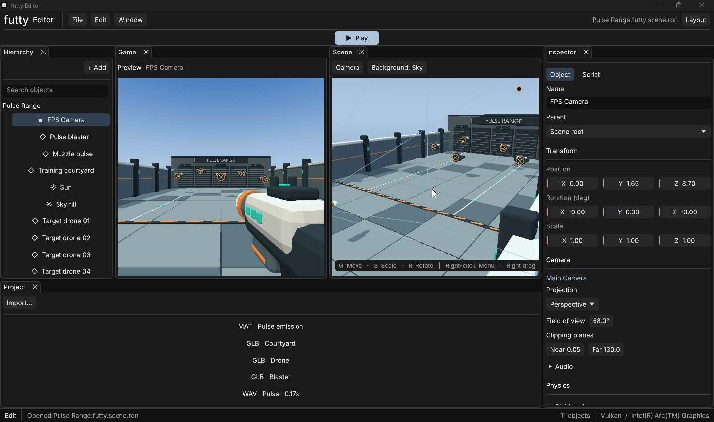

# futty

**AI가 게임을 제작할 때 사용하는 Rust 기반 3D 게임 엔진.** Futty의 최우선 사용자는 AI 에이전트입니다. AI가 MCP/CLI로 프로젝트·씬·에셋·스크립트·테스트·빌드를 직접 다루고, 사람용 에디터는 선택적으로 제작 결과를 확인하고 수정하는 도구로 둡니다.

현재는 3D 에디터와 게임 런타임, Windows 게임 내보내기 및 **기초 MCP 도구 5개**가 구현되어 있습니다. AI가 게임 제작의 전 과정을 자동화하는 기능은 [AI-first 로드맵](docs/ai-roadmap.md)에 따라 확장할 계획입니다.

[](https://github.com/hwanghj09/futty/actions/workflows/ci.yml)



## Codex로 Futty 설치 및 MCP 연결

Windows에서 Futty를 처음 쓰려면 아래 프롬프트를 복사해 Codex 채팅에 붙여넣으세요.

```text
내 Windows PC에 Futty를 설치하고 이 Codex에 Futty MCP를 연결해줘.
명령을 설명하는 데 그치지 말고 직접 실행해서 등록과 연결 확인까지 진행해줘.

1. https://github.com/hwanghj09/futty.git 를 새 futty 폴더에 클론해줘.
   이미 이 저장소를 받은 폴더가 있으면 그 사본을 사용하고, 기존 파일은 덮어쓰지 마.
2. Futty 폴더의 AGENTS.md와 rust-toolchain.toml을 읽어줘. Codex CLI, Rustup,
   Visual Studio C++ Build Tools(MSVC 및 Windows SDK)를 확인하고, 빠진 도구가
   있으면 설치 가능한 범위에서 설치해줘. 관리자 승인이나 재시작이 필요한 단계만 알려줘.
3. Futty 저장소 루트에서 아래 명령을 실행해서 서버를 빌드하고, 현재 Futty 폴더를
   작업 경로로 지정해 futty라는 이름으로 Codex MCP에 등록해줘.
   powershell -NoProfile -ExecutionPolicy Bypass -File scripts/connect-mcp.ps1
4. codex mcp get futty로 등록된 실행 파일과 작업 경로를 확인해줘.
   MCP 도구가 보이면 scene_inspect로 examples/agent-escape/Beacon Bot Escape.futty.scene.ron
   파일을 조회해 실제 응답을 확인해줘. 현재 채팅에 등록이 반영되지 않으면
   등록 결과를 보고하고 새 채팅이나 Codex 재시작이 필요한지 알려줘.
5. 마지막에 설치 경로와 등록 여부, 예제 씬 조회 결과를 알려줘.
```

[MCP 연결 상세 가이드](docs/guide.md#codex에서-futty-mcp-사용하기) · [AI-first 개발 로드맵](docs/ai-roadmap.md)

## 사람용 에디터 실행 (선택적)

Windows x64에서 Git, Rustup, Visual Studio C++ Build Tools의 **MSVC**와 **Windows SDK**가 필요합니다. Rust 버전은 `rust-toolchain.toml`에 고정되어 있습니다.

```powershell
git clone https://github.com/hwanghj09/futty.git
cd futty
cargo run --locked -p futty-editor
```

### Pulse Range로 시작하기

45초 동안 움직이는 드론을 맞히는 FPS 연습장입니다. 편집용 씬과 직접 모델링한 연습장·블래스터·드론, 효과음이 함께 들어 있습니다.

```powershell
cargo run --locked -p futty-editor -- --edit "examples/pulse-range/Pulse Range.futty.scene.ron"
```

에디터의 **Play**를 누른 뒤 게임 화면을 클릭합니다. **WASD**로 이동, **마우스**로 조준, **왼쪽 클릭**으로 발사, **R**로 재장전합니다. **Esc**로 일시정지하고 라운드가 끝나면 **Enter**로 다시 시작할 수 있습니다. [씬과 모델링 원본](examples/pulse-range/README.md)

## 주요 기능

| 기능 | 지원 범위 |
| --- | --- |
| 씬 편집 | 계층, 다중 선택, 이동·회전·크기 조절, 스냅, Undo/Redo, 연결형 프리팹 |
| 카메라와 렌더링 | 원근·정사영 카메라, Scene/Game 뷰, Sky 배경, wgpu 렌더링, 조명과 그림자 |
| 에셋 | GLB 메시·스켈레톤 애니메이션·UUID 유지 재가져오기, PNG 텍스처, 공유 머티리얼, Sprite3D, WAV·Ogg 효과음 |
| 게임 실행 | ECS 런타임, Rapier 물리, Rhai 스크립트, Windows 게임 내보내기 |
| 프로젝트 | 시작 씬 지정, 런타임 씬 전환, 여러 씬을 묶은 Windows 빌드 |
| 자동화 | 로컬 MCP 씬 조회·일괄 편집·Undo, 고정 틱 AI 플레이, 헤드리스 플레이테스트와 리플레이 |

## 예제

| 예제 | 열거나 실행하는 방법 |
| --- | --- |
| [Pulse Range](examples/pulse-range/) | 연습장 씬을 바로 열거나 프로젝트를 열어 로비에서 시작 |
| [Beacon Bot](examples/animation-playground/Beacon%20Bot.futty.scene.ron) | 씬을 열고 **Play**를 눌러 Idle·Walk·Signal 전환 |
| [Beacon Bot Escape](examples/agent-escape/Beacon%20Bot%20Escape.futty.scene.ron) | 에디터와 MCP에서 스위치를 켜 출구를 통과하거나 [플레이테스트 입력](examples/agent-escape/playtest.json)으로 성공 판정 확인 |
| [Prefab Workshop](examples/prefab-playground/Prefab%20Workshop.futty.scene.ron) | 원본을 편집해 인스턴스 갱신과 오버라이드 확인 |
| [Workshop GLB와 텍스처](examples/asset-preview/) | **Project → Import…**에서 GLB와 PNG 가져오기 |
| [Rhai 이동](examples/script-playground/) | **File → Script Playground** |
| [Sprite3D](examples/sprite-playground/) | **File → Sprite Playground** |
| [오디오 트리거](examples/audio-playground/) | **File → Audio Playground** |
| 물리 | **File → Physics Playground** |

## 문서

- [Futty AI-first 게임 제작 로드맵](docs/ai-roadmap.md)
- [게임 스킬 카탈로그](docs/game-skills.md)
- [에디터 사용 가이드](docs/guide.md)
- [Codex에서 Futty MCP 연결](docs/guide.md#codex에서-futty-mcp-사용하기) · GitHub에서 클론하거나 ZIP을 푼 뒤 Codex에서 폴더를 열고 **“Futty MCP 연결해줘”**라고 입력하세요.
- [Windows 게임 내보내기](docs/guide.md#windows-게임-내보내기)

## 저장소 구조

| 경로 | 역할 |
| --- | --- |
| [`crates/futty-editor`](crates/futty-editor/) | 에디터 UI, 씬 플레이어, Windows 내보내기 |
| [`crates/futty-runtime`](crates/futty-runtime/) | 씬 포맷, ECS, 물리, 스크립트 |
| [`crates/futty-render`](crates/futty-render/) · [`shaders`](shaders/) | wgpu 렌더러와 WGSL 셰이더 |
| [`crates/futty-core`](crates/futty-core/) · [`crates/futty-assets`](crates/futty-assets/) · [`crates/futty-audio`](crates/futty-audio/) | 공용 타입, 에셋 로딩, 오디오 |
| [`crates/futty-mcp`](crates/futty-mcp/) | 로컬 stdio MCP 서버 |
